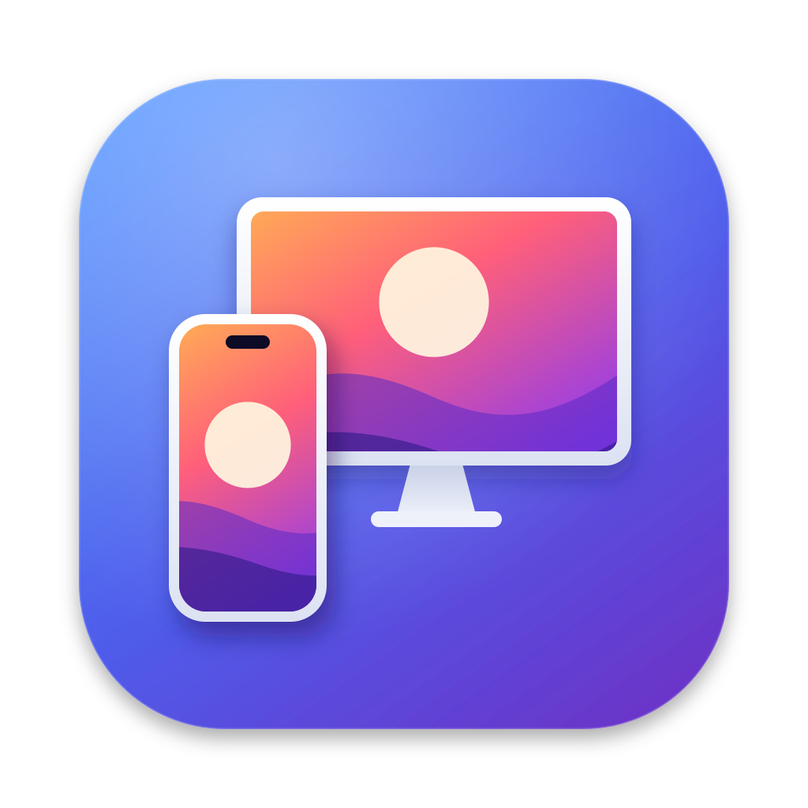
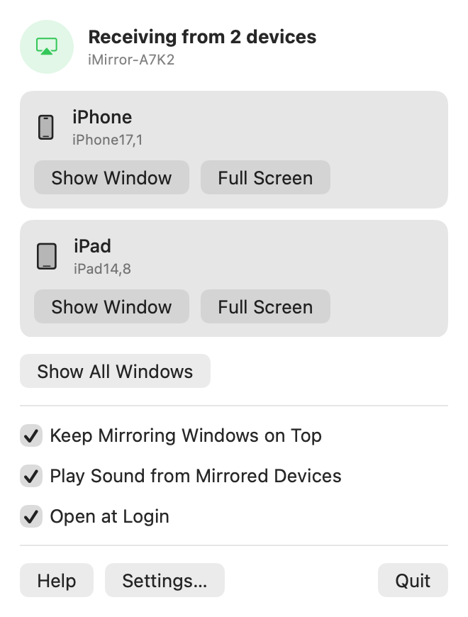
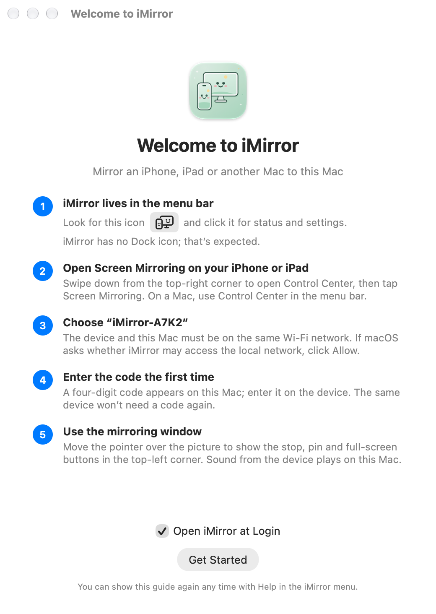
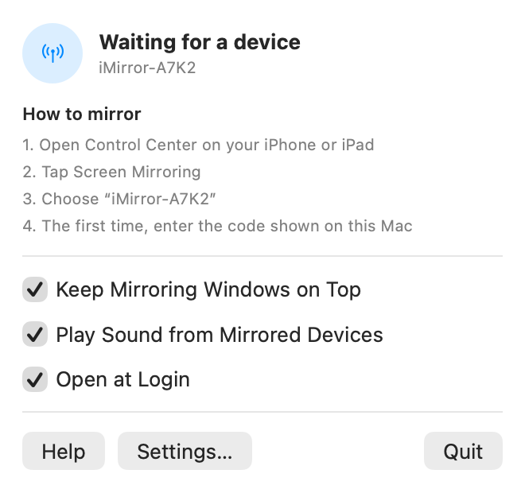
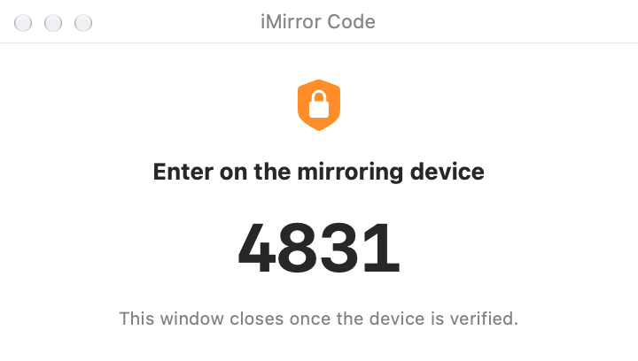
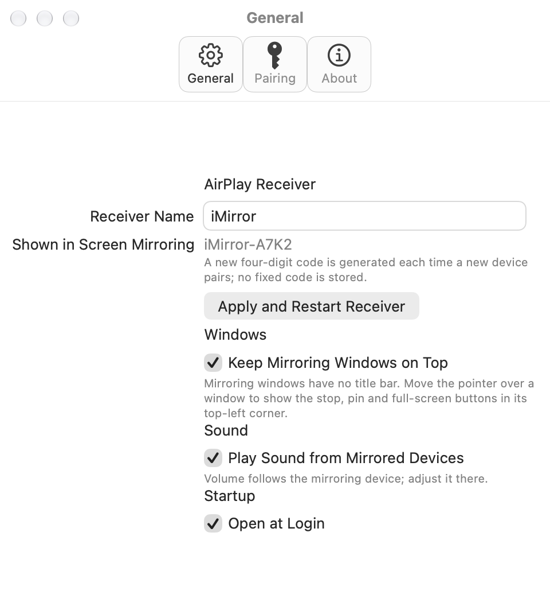

<p align="center"></p>

<h1 align="center">iMirror</h1>

<p align="center"><strong>Mirror your iPhone and iPad to your Mac.</strong><br>
A free, open-source AirPlay screen mirroring receiver that lives in the macOS menu bar.</p>

<p align="center">
  <a href="https://github.com/erniu96/iMirror/releases/latest"></a>
  
  
  <a href="COPYING"></a>
</p>

<p align="center">English · <a href="README.zh-CN.md">简体中文</a></p>

<p align="center">
  <picture>
    <source media="(prefers-color-scheme: dark)" srcset="Documentation/Screenshots/en/dark/menu-streaming.png">
    
  </picture>
  &nbsp;
  <picture>
    <source media="(prefers-color-scheme: dark)" srcset="Documentation/Screenshots/en/dark/welcome.png">
    
  </picture>
</p>

Open Control Center on your iPhone, tap **Screen Mirroring**, pick your Mac, and the picture appears in a floating window that can stay on top of everything else, with sound. Nothing to install on the phone.

## Features

- **Lives in the menu bar.** No Dock icon. The menu shows the connection status, how to mirror, and quick switches.
- **Several devices at once.** An iPhone, an iPad and another Mac can mirror at the same time, each in its own window with its own decoder.
- **Floating windows.** Borderless, resizable and on top by default. Stop, pin and full-screen buttons appear on hover. The aspect ratio is kept through rotation, resizing and full screen.
- **Fast.** H.264 decoded in hardware by VideoToolbox and drawn with Metal, up to 1920×1080 at 60 fps.
- **Sound.** Plays the device's audio (AAC-ELD, AAC-LC, ALAC, PCM), following its volume. Can be turned off.
- **Code pairing.** A new random four-digit code appears on the Mac for each new device; no fixed password is stored. Verified devices reconnect without a code, and you can forget them all at once.
- **Always ready.** Optional open at login. Stops advertising while the Mac sleeps and resumes on wake. The receiver name carries a per-Mac tag such as `iMirror-A7K2`, so several Macs never get mixed up.
- **English and Simplified Chinese**, following the system language. [More languages are welcome](Documentation/LOCALIZATION.md).
- **Private.** Everything stays on your local network. No account, ads or analytics.

## Screenshots

| Waiting for a device | First pairing | Settings |
| :---: | :---: | :---: |
| <picture><source media="(prefers-color-scheme: dark)" srcset="Documentation/Screenshots/en/dark/menu-ready.png"></picture> | <picture><source media="(prefers-color-scheme: dark)" srcset="Documentation/Screenshots/en/dark/code.png"></picture> | <picture><source media="(prefers-color-scheme: dark)" srcset="Documentation/Screenshots/en/dark/settings.png"></picture> |

The screenshots are rendered from the app's own views by [`Scripts/render-screenshots.sh`](Scripts/render-screenshots.sh).

## Download and install

Requires **macOS 14 Sonoma or later**. One download runs on both Apple silicon and Intel Macs.

1. Download `iMirror-<version>-macOS-universal.dmg` from **[the latest release](https://github.com/erniu96/iMirror/releases/latest)**.
2. Open the DMG and drag iMirror onto the Applications folder.
3. Open iMirror and allow it past Gatekeeper once (see below).
4. When macOS asks, allow iMirror to access the local network. Otherwise your iPhone can't find it.

### First launch: getting past Gatekeeper

Releases are built by GitHub Actions from this source, ad-hoc signed and **not notarized by Apple**, so macOS blocks the first launch. Use any one of these:

- **macOS 15 and later:** open iMirror once and click **Done** in the warning. Then go to **System Settings → Privacy & Security**, click **Open Anyway** near the bottom, and confirm with your password.
- **macOS 14:** Control-click (or right-click) iMirror, choose **Open**, then click **Open**.
- **Terminal (any version):** also use this if macOS says the app "is damaged". It only removes the download quarantine flag and doesn't modify the app.

  ```bash
  xattr -dr com.apple.quarantine /Applications/iMirror.app
  ```

Each release also includes a `.sha256` file; `shasum -a 256 iMirror-*.dmg` should print the same value.

## Usage

1. Open iMirror. An icon (a phone and a display) appears in the menu bar. There's no Dock icon; that's expected.
2. On your iPhone or iPad, swipe down from the top-right corner to open Control Center and tap **Screen Mirroring**. On a Mac, use Control Center in the menu bar.
3. Choose the name with this Mac's tag, for example `iMirror-A7K2`.
4. The first time, enter the four-digit code shown on the Mac. The same device won't need a code again.

Move the pointer over the picture to show the stop, pin and full-screen buttons. Settings let you rename the receiver, keep windows on top, turn sound off, open at login, and forget paired devices. To use a different language for iMirror alone, go to System Settings → General → Language & Region → Applications.

## Troubleshooting

**iMirror doesn't show up in Screen Mirroring**

1. Check that iMirror is running and its menu says "Waiting for a device".
2. Make sure the device and the Mac are on the same Wi-Fi network, and the router doesn't isolate clients (AP or guest isolation).
3. On macOS 15 and later, check System Settings → Privacy & Security → Local Network and make sure iMirror is on.
4. If the macOS firewall is on, allow incoming connections for iMirror.
5. On some macOS versions, **AirPlay Receiver** in System Settings → General → AirDrop & Handoff must stay on so the peer-to-peer (AWDL) interface is available.

**"iMirror is damaged and can't be opened"**: run the `xattr` command above.

**Uninstall**: turn off Open at Login in Settings and quit iMirror, then delete `/Applications/iMirror.app`. To also remove the receiver identity, paired devices and settings, delete `~/Library/Application Support/iMirror` and run `defaults delete com.erniu.imirror`.

## Feedback and contributing

- **Bugs and feature requests:** [open an issue](https://github.com/erniu96/iMirror/issues/new/choose). Please include your macOS version, Mac model, the mirroring device and model, and what happened.
- **Translations:** copy `Resources/en.lproj`, translate it, and follow the [localization guide](Documentation/LOCALIZATION.md).
- **Code:** pull requests are welcome. Run `./build.sh test` before submitting. The design is described in [ARCHITECTURE.md](Documentation/ARCHITECTURE.md).

## Limitations

- Screen mirroring only: H.264 up to 1920×1080 at 60 fps. HEVC, 4K and audio-only AirPlay aren't supported yet.
- Automated tests cover the protocol, decoding and audio, but not real-device discovery, pairing, AWDL or the Metal window; those are checked by hand on a Mac.

## Building from source

Requires macOS 14 or later and the Xcode Command Line Tools (`xcode-select --install`). Homebrew is not needed.

```bash
bash install.sh      # build, install into /Applications and open
./build.sh test      # build and run all tests
bash command.txt     # build and run from build/ for development
```

- `install.sh` quits a running copy, installs with `ditto` (asking for an administrator password if needed), and opens the app. `--no-open` installs without opening; `IMIRROR_INSTALL_DIR` installs elsewhere. Use the installed copy day to day: Open at Login needs a fixed location.
- The first build downloads OpenSSL 3.6.3 from the official GitHub release (about 53 MB), verifies its SHA-256 and compiles it into `.dependencies`; later builds reuse it. Set `IMIRROR_OPENSSL_URL` to use a mirror of the same file (the checksum is still checked), or `IMIRROR_OPENSSL_PREFIX` to use your own OpenSSL 3 build.
- Builds target macOS 14 by default. Set `IMIRROR_MINIMUM_MACOS`, e.g. `IMIRROR_MINIMUM_MACOS=15.0 ./build.sh`, for a higher minimum; each minimum gets its own OpenSSL build.
- Local builds are ad-hoc signed and the signature changes with every build, so macOS may ask for local network or firewall permission again. For signed and notarized distribution, see [DISTRIBUTION.md](Documentation/DISTRIBUTION.md).
- DMG: `python3 -m pip install dmgbuild`, then `./Scripts/make-dmg.sh build/iMirror.app iMirror.dmg`. The window background is rendered from `Resources/DMG/background.svg`.
- App icon: edit `Resources/AppIcon.svg`, then run `node Scripts/make-app-icon.mjs` (needs Node and Playwright Chromium) and commit the regenerated `AppIcon.icns`.
- Screenshots: `./Scripts/render-screenshots.sh Documentation/Screenshots` renders the menu, settings, guide and code windows in every language and appearance, using sample data and without starting the receiver.

### Tests

`./build.sh test` builds the app, checks the signature, and runs the protocol tests, Swift unit tests, two independent H.264 decoding tests and the audio decoding tests (AAC-ELD, AAC-LC and ALAC produced with the system encoder, then decoded with AirPlay's negotiated parameters). The video sample is generated and stored in `Tests/Fixtures/`; set `IMIRROR_VIDEO_FIXTURE` to use another Annex-B H.264 file.

GitHub Actions runs the full suite on Apple silicon and Intel macOS 15 runners, with `IMIRROR_ALLOW_SOFTWARE_DECODER=1` because the virtual machines have no hardware decoder. The app itself still requires hardware decoding.

To test only the portable C protocol module on macOS or Linux (Linux needs a C compiler and OpenSSL 3 headers):

```bash
./Scripts/test-protocol.sh
```

On Linux desktops, [UxPlay](https://github.com/FDH2/UxPlay), the upstream of iMirror's protocol layer, is an AirPlay receiver you can use directly.

### Releasing

Add a section for the new version at the top of [CHANGELOG.md](CHANGELOG.md), then push a tag matching `CFBundleShortVersionString` in `Resources/Info.plist` (e.g. `v1.2.1`). [`release.yml`](.github/workflows/release.yml) builds and tests on Apple silicon and Intel, merges a universal app, ad-hoc signs it, makes the DMG and publishes it with a SHA-256 file. The release notes combine the CHANGELOG section, a compare link and [`.github/release-notes.md`](.github/release-notes.md); the release fails if the CHANGELOG has no section for the version.

## How it works

There is no public framework for third-party AirPlay receivers. iMirror advertises `_airplay._tcp` and `_raop._tcp` with Bonjour, using the public DNS-SD peer-to-peer flags so devices can also reach it over AWDL. An open-source AirPlay/RAOP protocol layer derived from UxPlay handles pairing and the session; video goes through VideoToolbox to Metal, and audio through AudioConverter to AVAudioEngine. See [ARCHITECTURE.md](Documentation/ARCHITECTURE.md).

## License

The protocol layer is derived from [UxPlay](https://github.com/FDH2/UxPlay), licensed under the GPLv3, so iMirror as a whole is distributed under the [GNU GPLv3](COPYING). Third-party notices are in [ThirdParty/NOTICE.md](ThirdParty/NOTICE.md).

AirPlay, iPhone, iPad and Mac are trademarks of Apple Inc. iMirror is not affiliated with or endorsed by Apple.
