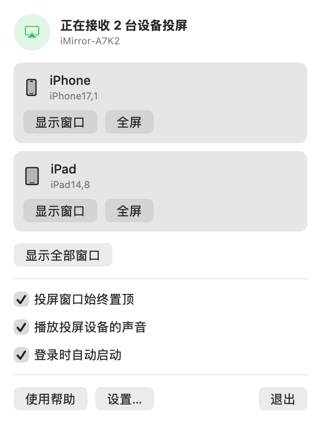
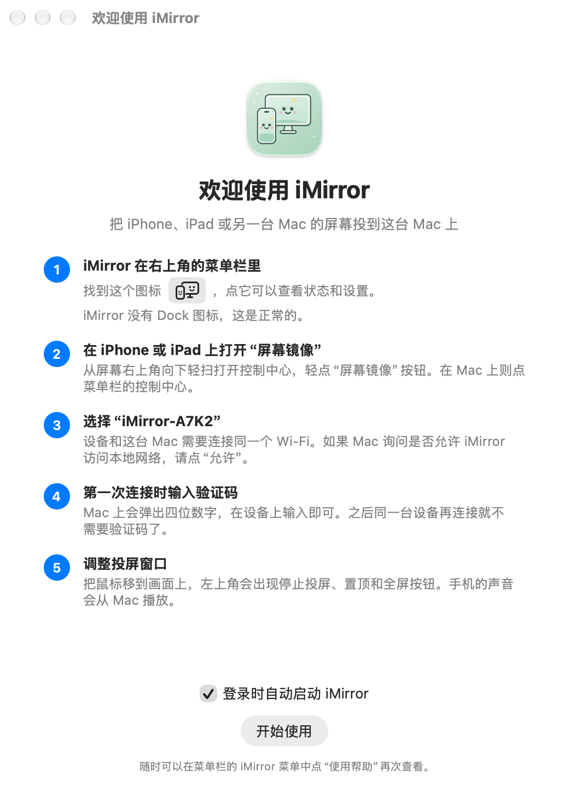
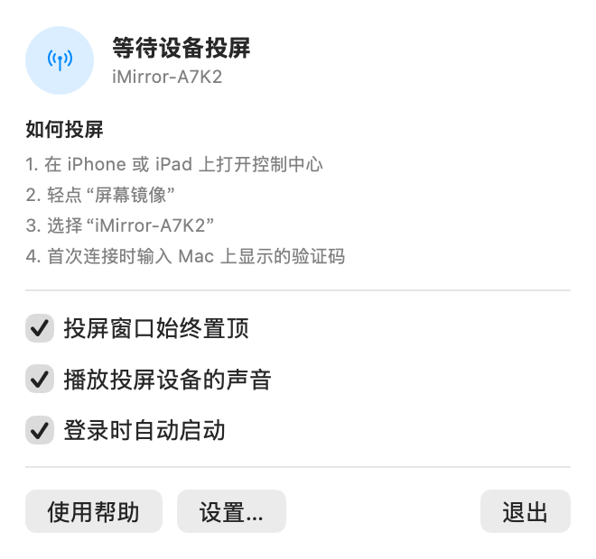
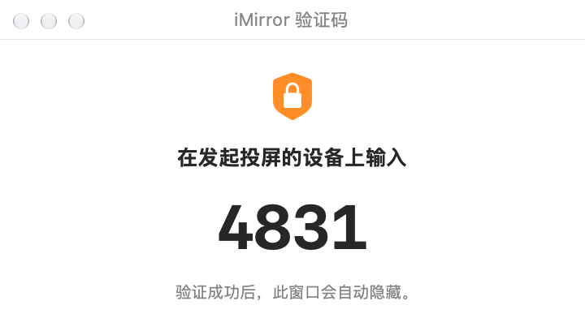
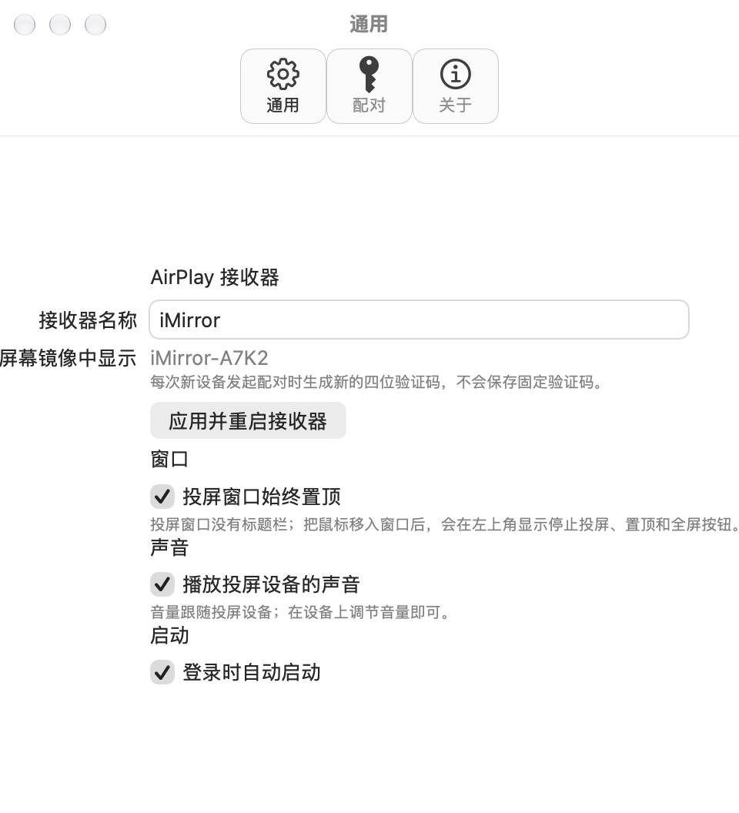

<p align="center"></p>

<h1 align="center">iMirror</h1>

<p align="center"><strong>把 iPhone、iPad 的屏幕投到 Mac 上。</strong><br>
免费开源、常驻 macOS 菜单栏的 AirPlay 投屏接收器。</p>

<p align="center">
  <a href="https://github.com/erniu96/iMirror/releases/latest"></a>
  
  
  <a href="COPYING"></a>
</p>

<p align="center"><a href="README.md">English</a> · 简体中文</p>

<p align="center">
  <picture>
    <source media="(prefers-color-scheme: dark)" srcset="Documentation/Screenshots/zh-Hans/dark/menu-streaming.png">
    
  </picture>
  &nbsp;
  <picture>
    <source media="(prefers-color-scheme: dark)" srcset="Documentation/Screenshots/zh-Hans/dark/welcome.png">
    
  </picture>
</p>

在 iPhone 控制中心点 **屏幕镜像**，选这台 Mac，画面就出现在一个可以置顶的悬浮窗口里，声音也一起过来。手机上不用装任何 App。

## 功能

- **常驻菜单栏**：没有 Dock 图标。菜单里显示连接状态、投屏步骤和常用开关。
- **多台设备同时投屏**：iPhone、iPad、另一台 Mac 可以同时投过来，每台一个独立窗口、独立解码，断开一台不影响其他。
- **悬浮窗口**：无标题栏、可缩放、默认置顶；鼠标移入才显示停止、置顶和全屏按钮。横竖屏切换、缩放和全屏时都保持画面比例。
- **流畅**：VideoToolbox 硬件解码 H.264，Metal 直接显示，最高 1920×1080、60 帧。
- **声音**：播放投屏设备的声音（AAC-ELD、AAC-LC、ALAC、PCM），音量跟随设备，可以关闭。
- **验证码配对**：每台新设备连接时在 Mac 上生成新的随机四位验证码，不保存固定密码；验证过的设备之后免验证码，也可一键全部遗忘。
- **随时可用**：可设置登录时启动；Mac 睡眠时停止广播，唤醒后自动恢复。接收器名称带本机标记（如 `iMirror-A7K2`），多台 Mac 不会混淆。
- **简体中文和英文界面**，跟随系统语言；欢迎[贡献更多语言](Documentation/LOCALIZATION.md)。
- **隐私**：数据只在局域网内传输，不需要账号，没有广告和统计。

## 截图

| 等待连接 | 首次配对 | 设置 |
| :---: | :---: | :---: |
| <picture><source media="(prefers-color-scheme: dark)" srcset="Documentation/Screenshots/zh-Hans/dark/menu-ready.png"></picture> | <picture><source media="(prefers-color-scheme: dark)" srcset="Documentation/Screenshots/zh-Hans/dark/code.png"></picture> | <picture><source media="(prefers-color-scheme: dark)" srcset="Documentation/Screenshots/zh-Hans/dark/settings.png"></picture> |

截图由 [`Scripts/render-screenshots.sh`](Scripts/render-screenshots.sh) 直接渲染应用自身的界面生成。

## 下载安装

需要 **macOS 14 Sonoma 或更高版本**，同一个安装包支持 Apple Silicon 和 Intel Mac。

1. 从 **[最新版本](https://github.com/erniu96/iMirror/releases/latest)** 下载 `iMirror-<版本>-macOS-universal.dmg`。
2. 双击打开 dmg，把 iMirror 拖到“应用程序”文件夹。
3. 打开 iMirror，按下文放行一次 Gatekeeper。
4. macOS 询问时，允许 iMirror 访问本地网络，否则 iPhone 找不到它。

### 首次打开：放行 Gatekeeper

发布版由 GitHub Actions 从本仓库源码自动构建，使用 ad-hoc 签名，**没有经过 Apple 公证**，所以 macOS 第一次会拦截。任选一种方式：

- **macOS 15 及以上**：先双击打开一次，在提示中点 **完成**；然后到 **系统设置 → 隐私与安全性**，在底部点 **仍要打开**，输入密码确认。
- **macOS 14**：按住 Control 点按（或右键）iMirror，选 **打开**，再点 **打开**。
- **终端（所有版本）**：提示“已损坏，无法打开”时也用这条命令。它只移除下载时附加的隔离标记，不修改应用本身。

  ```bash
  xattr -dr com.apple.quarantine /Applications/iMirror.app
  ```

每个版本都附有 `.sha256` 文件，`shasum -a 256 iMirror-*.dmg` 的结果应与之一致。

## 使用

1. 打开 iMirror，菜单栏出现一个图标（手机和显示器）。iMirror 没有 Dock 图标，这是正常的。
2. 在 iPhone 或 iPad 上从屏幕右上角向下轻扫打开控制中心，轻点 **屏幕镜像**。在 Mac 上则点菜单栏的控制中心。
3. 选择带本机标记的名称，例如 `iMirror-A7K2`。
4. 第一次连接时，输入 Mac 上显示的四位验证码。同一台设备之后不用再输。

鼠标移到投屏画面上会出现停止、置顶和全屏按钮。在设置中可以修改接收器名称、窗口置顶、关闭声音、登录时启动、遗忘已配对设备。想单独为 iMirror 换语言，可在“系统设置 → 通用 → 语言与地区 → App”中设置。

## 常见问题

**“屏幕镜像”里找不到 iMirror**

1. 确认 iMirror 正在运行，菜单显示“等待设备投屏”。
2. 确认设备和 Mac 在同一个 Wi-Fi，路由器没有开启 AP 隔离或访客网络隔离。
3. macOS 15 及以上，检查“系统设置 → 隐私与安全性 → 本地网络”中 iMirror 已打开。
4. 开了 macOS 防火墙时，允许 iMirror 的传入连接。
5. 部分 macOS 版本需要在“系统设置 → 通用 → 隔空投送与接力”中保持 **隔空播放接收器** 开启，点对点（AWDL）接口才可用。

**提示“iMirror 已损坏，无法打开”**：运行上面的 `xattr` 命令。

**卸载**：在设置中关闭“登录时启动”并退出 iMirror，然后删除 `/Applications/iMirror.app`。如需同时清除接收器身份、已配对设备和设置，删除 `~/Library/Application Support/iMirror` 并运行 `defaults delete com.erniu.imirror`。

## 反馈与贡献

- **问题和建议**：[提交 Issue](https://github.com/erniu96/iMirror/issues/new/choose)，请附上 macOS 版本、Mac 机型、投屏设备及型号和问题现象。
- **翻译**：复制 `Resources/en.lproj` 翻译即可，详见[翻译指南](Documentation/LOCALIZATION.md)。
- **代码**：欢迎 Pull Request，提交前请运行 `./build.sh test`。设计说明见 [ARCHITECTURE.md](Documentation/ARCHITECTURE.md)。

## 已知限制

- 只支持屏幕镜像：H.264，最高 1920×1080、60 帧。暂不支持 HEVC、4K 和纯音频 AirPlay。
- 自动化测试覆盖协议、视频和音频解码，不覆盖真机发现、配对、AWDL 和 Metal 窗口显示，这些在 Mac 上手动验收。

## 从源码构建

需要 macOS 14 或更高版本和 Xcode Command Line Tools（`xcode-select --install`），不需要 Homebrew。

```bash
bash install.sh      # 编译、安装到“应用程序”并启动
./build.sh test      # 构建并运行全部测试
bash command.txt     # 开发调试：构建后直接从 build/ 启动
```

- `install.sh` 会退出正在运行的旧版本，用 `ditto` 安装（没有写权限时通过 `sudo` 请求管理员密码）并启动。`--no-open` 只安装不启动；`IMIRROR_INSTALL_DIR` 可安装到其他目录。日常请使用安装后的版本，“登录时启动”需要应用位于固定路径。
- 首次构建会从 OpenSSL 官方 GitHub Release 下载 3.6.3 源码（约 53 MB），校验 SHA-256 后编译到 `.dependencies`，之后直接复用。下载慢时可用 `IMIRROR_OPENSSL_URL` 指向同一文件的镜像（仍会校验）；已有自己编译的 OpenSSL 3 时用 `IMIRROR_OPENSSL_PREFIX` 指定。
- 默认以 macOS 14 为最低版本。需要更高时设置 `IMIRROR_MINIMUM_MACOS`，例如 `IMIRROR_MINIMUM_MACOS=15.0 ./build.sh`；每个最低版本单独编译一份 OpenSSL。
- 本地构建使用 ad-hoc 签名，每次构建签名都会变化，系统可能再次询问本地网络或防火墙权限，属正常现象。需要正式签名和公证时见[分发文档](Documentation/DISTRIBUTION.md)。
- 制作 dmg：`python3 -m pip install dmgbuild` 后运行 `./Scripts/make-dmg.sh build/iMirror.app iMirror.dmg`。窗口背景由 `Resources/DMG/background.svg` 渲染。
- 应用图标：修改 `Resources/AppIcon.svg` 后运行 `node Scripts/make-app-icon.mjs`（需要 Node 和 Playwright Chromium），连同重新生成的 `AppIcon.icns` 一起提交。
- 截图：`./Scripts/render-screenshots.sh Documentation/Screenshots` 用示例数据渲染各语言、浅色和深色下的菜单、设置、引导和验证码窗口，不会启动接收器。

### 测试

`./build.sh test` 会构建应用、检查签名，并运行协议测试、Swift 单元测试、两路独立的 H.264 解码测试和音频解码测试（用系统编码器生成 AAC-ELD、AAC-LC、ALAC 数据，再按 AirPlay 协商参数解码）。视频样本由程序生成，存放在 `Tests/Fixtures/`；可用 `IMIRROR_VIDEO_FIXTURE` 指定其他 Annex-B H.264 文件。

GitHub Actions 在 Apple Silicon 和 Intel 的 macOS 15 环境中运行完整测试；虚拟机没有硬件解码器，因此设置 `IMIRROR_ALLOW_SOFTWARE_DECODER=1`，应用本身仍要求硬件解码。

只验证可移植的 C 协议模块时，在 macOS 或 Linux 上运行（Linux 需要 C 编译器和 OpenSSL 3 开发包）：

```bash
./Scripts/test-protocol.sh
```

Linux 桌面用户如需 AirPlay 接收器，可直接使用本项目协议层的上游 [UxPlay](https://github.com/FDH2/UxPlay)。

### 发布

先在 [CHANGELOG.md](CHANGELOG.md) 顶部写好新版本的改动，再推送与 `Resources/Info.plist` 中 `CFBundleShortVersionString` 一致的标签（例如 `v1.2.1`）。[`release.yml`](.github/workflows/release.yml) 会在 Apple Silicon 和 Intel 上分别构建、测试，合并为 universal 应用，ad-hoc 签名，制作 dmg，并连同 SHA-256 文件发布。Release 说明由 CHANGELOG 对应版本、对比链接和 [`.github/release-notes.md`](.github/release-notes.md) 组成；CHANGELOG 缺少该版本时发布会失败。

## 工作原理

Apple 没有给第三方提供公开的 AirPlay 接收器框架。iMirror 用 Bonjour 广播 `_airplay._tcp` 和 `_raop._tcp`，并使用公开的 DNS-SD 点对点标志，让设备也能经 AWDL 找到它；配对与会话由基于 UxPlay 的开源 AirPlay/RAOP 协议层处理，视频经 VideoToolbox 交给 Metal 显示，音频经 AudioConverter 交给 AVAudioEngine 播放。详见[架构文档](Documentation/ARCHITECTURE.md)。

## 许可证

协议层派生自 GPLv3 许可的 [UxPlay](https://github.com/FDH2/UxPlay)，因此 iMirror 整体按 [GNU GPLv3](COPYING) 分发。第三方声明见 [ThirdParty/NOTICE.md](ThirdParty/NOTICE.md)。

AirPlay、iPhone、iPad 和 Mac 是 Apple Inc. 的商标。iMirror 与 Apple 没有关联，也未获其认可。
